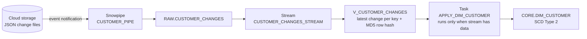

# Snowflake Incremental CDC Pipeline (Snowpipe, Streams, Tasks, SCD Type 2)

> **Representative portfolio project.** Independently written; all names, buckets, and data are placeholders or synthetic. It is not code from any employer or client.

Customer change events land as JSON in cloud storage, Snowpipe loads them into a raw table, a stream captures new rows, and a task applies them to an SCD Type 2 dimension. Warehouse cost is capped with a resource monitor and access is split into loader, transformer, and analyst roles.

## Business problem

Analytics teams need a customer dimension that is current within minutes and keeps history (for example, which segment a customer was in when an order was placed), without full reloads and without runaway compute cost.

## Architecture



| File | Purpose |
|---|---|
| `sql/00_platform_rbac.sql` | XS warehouse with auto-suspend, monthly resource monitor (notify at 80%, suspend at 100%), LOADER / TRANSFORMER / ANALYST roles with future grants |
| `sql/01_ingest_snowpipe.sql` | JSON file format, external stage via storage integration, raw table with `_file_name` lineage, auto-ingest pipe |
| `sql/02_core_objects.sql` | Append-only stream, SCD2 dimension, de-duplicating change view |
| `sql/scd2_apply.sql` | The two SCD2 statements (expire changed rows, insert new versions) |
| `sql/03_task.sql.j2` | Task wrapping the SCD2 statements in one transaction |
| `src/sf_cdc/` | Renders SQL from `config/dev.yaml`; deploys with key-pair auth or prints with `--dry-run` |

## How the SCD2 logic is tested

`sql/scd2_apply.sql` is written in SQL that both Snowflake and DuckDB accept. The unit tests run those exact statements on DuckDB and check:

- new customers get one current row
- a changed attribute closes the old row (`valid_to`) and opens a new one
- unchanged records do not create versions
- only the latest change per customer in a batch is applied
- re-running the same batch is idempotent
- NULL attributes do not break change detection

```bash
pip install -e ".[dev]"
pytest -q
python -m sf_cdc.deploy --dry-run      # prints fully rendered SQL (see docs/rendered_dev.sql)
```

Deploying to a real account:

```bash
pip install -e ".[snowflake]"
cp .env.example .env   # account, user, path to private key; never commit this file
python -m sf_cdc.deploy --config config/dev.yaml
```

## What has and has not been verified

- Verified: SCD2 behavior (DuckDB unit tests), template rendering, lint, CI.
- Not verified here: execution against a live Snowflake account (stage, pipe, stream, and task DDL). Review them in a sandbox account before use.

## Security notes

- Storage access uses a storage integration created by an admin; no cloud keys in code.
- Snowflake credentials are read from environment variables using key-pair auth.
- Roles follow least privilege; analysts can only read `CORE`.

## Limitations and next steps

- Deletes are not handled; add a soft-delete flag or a `METADATA$ACTION = 'DELETE'` path with a standard (non append-only) stream.
- Add task failure alerts (`ERROR_INTEGRATION`) and a data-freshness check.
- Move to dbt snapshots if the team already uses dbt.

## License

MIT
